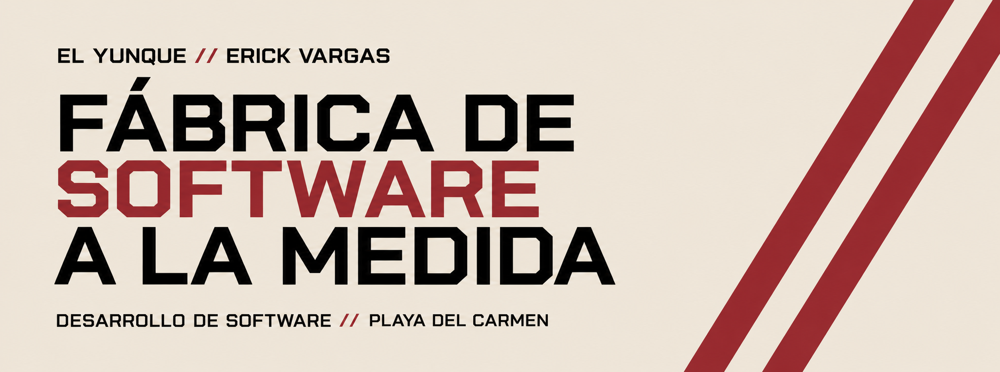

<h2 align="center">ERICK VARGAS</h2>

  <strong>FULL STACK DEVELOPER</strong> &nbsp;//&nbsp; SOFTWARE ENGINEERING

  <a href="https://erickvargas.dev">PORTAFOLIO</a>
  &nbsp; / &nbsp;
  <a href="https://github.com/evargasdev">GITHUB</a>
  &nbsp; / &nbsp;
  <a href="mailto:erickdanielvargascorona@gmail.com">CONTACTO</a>

---

### 01 / SOBRE MÍ

Soy Erick, desarrollador de software apasionado por transformar ideas y problemas complejos en soluciones funcionales.

Me gusta explorar nuevas tecnologías, entender cómo funcionan las cosas y construir herramientas que tengan un propósito. Siempre estoy aprendiendo, experimentando y buscando mejores formas de desarrollar software.

### 02 / STACK

**FRONTEND**

**BACKEND**

**DATABASE & INFRASTRUCTURE**

**TOOLS & WORKFLOW**

### 03 / GITHUB ACTIVITY

  
  

  

  

---

  <strong>EL YUNQUE // ERICK VARGAS</strong> 
  SOFTWARE A LA MEDIDA · PLAYA DEL CARMEN, MX
    
  <a href="https://erickvargas.dev">erickvargas.dev</a>

